<div align="center">



<br />


<br /><br />

**A living, interactive sketchbook footer — built with raw precision by THENUX.**

Hand-drawn SVG mascots sit on giant ink-stamped typography.<br />
Their eyes follow your cursor. Every line boils. Every doodle drifts.

<br />

<a href="#component-preview"></a>
<a href="#core-features"></a>
<a href="#meet-the-crew"></a>
<a href="#installation"></a>
<a href="#quick-start"></a>
<a href="#props-reference"></a>
<a href="#presets--palette"></a>
<a href="#license--credits"></a>

</div>



## Component Preview

<div align="center">


<sub><b>THENUX Doodle Crew Footer</b> — interactive character crew, drifting ink doodles, and responsive brand navigation.</sub>

</div>


## Core Features

<table>
  <tr>
    <td width="50%" valign="top">
      <h3>Ink-Stamped Typography</h3>
      The ground line draws itself, letters stamp down one-by-one with ink dust puffs, and the crew pops up dynamically.
    </td>
    <td width="50%" valign="top">
      <h3>Eye Tracking &amp; Blinking</h3>
      Every crew member's pupils smoothly track the cursor in real time and blink at randomized intervals.
    </td>
  </tr>
  <tr>
    <td width="50%" valign="top">
      <h3>Interactive Crew Mascots</h3>
      Six hand-drawn characters, each with its own pose, click reaction, and speech line. <a href="#meet-the-crew">Meet them below.</a>
    </td>
    <td width="50%" valign="top">
      <h3>Drifting Doodles</h3>
      Physics-based floating ink doodles — flames, stars, bolts, sparkles, spirals — that scatter away when the pointer approaches and pop when clicked.
    </td>
  </tr>
  <tr>
    <td width="50%" valign="top">
      <h3>Line-Boil Animation</h3>
      Real hand-drawn 8 FPS line-boil, simulated with inline SVG fractal noise and displacement filters.
    </td>
    <td width="50%" valign="top">
      <h3>Zero External Dependencies</h3>
      Pure React with inline SVGs, CSS keyframe animations, and Canvas-based font measurement. No Framer Motion, no heavy bundles.
    </td>
  </tr>
  <tr>
    <td width="50%" valign="top">
      <h3>Full Theme Support</h3>
      Built-in <code>thenux</code> obsidian dark preset, plus <code>paper</code>, <code>night</code>, <code>riso</code>, <code>sunny</code>, and <code>auto</code> system tokens.
    </td>
    <td width="50%" valign="top">
      <h3>Fully Configurable</h3>
      Swap the wordmark, crew, doodles, links, actions, and palette through typed props. Switch interactivity off in one flag.
    </td>
  </tr>
</table>


## Meet the Crew

| Letter | Mascot | Behavior | Says on click |
| :---: | :--- | :--- | :--- |
|  | **Bruno** | Leans on the letter, hops on click | *"THENUX engine online. Ready to build?"* |
|  | **Pip** | Perches on top, pecks and tweets | *"Autonomous agents running at full speed!"* |
|  | **Morel** | Sits at the baseline | *"Neural tokens loaded. 100% verified."* |
|  | **Juno** | Dangles legs from the top edge | *"Up here! Best view of the THENUX workspace."* |
|  | **Boo** | Peeks from behind the letter | *"Zero latency. High precision intelligence."* |
|  | **Patch** | Stands at the right edge with a waving tail | *"Built by THENUX. Clean code only."* |


## Installation

Copy the component from [`Footerprompt.md`](./Footerprompt.md) into your UI components directory:

```bash
# Recommended shadcn path
src/components/ui/doodle-crew-footer.tsx
```


## Quick Start

```tsx
import DoodleCrewFooter from "@/components/ui/doodle-crew-footer"

export default function LayoutFooter() {
  return (
    <DoodleCrewFooter
      wordmark="THENUX"
      brand="THENUX AI"
      tagline="Autonomous Intelligence & Modern Architecture by THENUX. Built for the builders."
      preset="thenux"
    />
  )
}
```


## Props Reference

| Prop | Type | Default | Description |
| :--- | :--- | :--- | :--- |
| `wordmark` | `string` | `"THENUX"` | Giant ink-stamped center wordmark. Best with 4–8 uppercase characters. |
| `brand` | `string` | `"THENUX AI"` | Brand name displayed at the top left header with insignia. |
| `blurb` | `string` | *THENUX bio* | Descriptive paragraph under the brand header. |
| `tagline` | `string` | *THENUX tagline* | Call-to-action headline animated under the wordmark. |
| `preset` | `DoodleCrewPreset` | `"thenux"` | Preset color scheme: `"thenux"`, `"paper"`, `"night"`, `"riso"`, `"sunny"`, `"auto"`. |
| `palette` | `object` | *preset tokens* | Overrides individual preset tokens, e.g. `background`, `ink`, `accent`. |
| `columns` | `FooterColumn[]` | *THENUX links* | Navigation columns (Platform, Integrations, Developers, Company). |
| `actions` | `FooterAction[]` | *THENUX actions* | Interactive pill buttons (`"Launch THENUX AI"`, `"Connect Workspace Tools"`). |
| `copyright` | `string` | `"© 2026 THENUX..."` | Bottom copyright and legal disclaimer notice. |
| `crew` | `CrewMember[]` | *THENUX crew* | Custom array of crew members, letters, seats, and dialogue lines. |
| `doodles` | `DoodleKind[]` | *Default doodles* | Floating physics doodles (`flame`, `star`, `bolt`, `sparkle`, `spiral`, etc.). |
| `doodleCount` | `number` | `14` | Number of simultaneous drifting doodles on screen. |
| `interactive` | `boolean` | `true` | Enables/disables mouse tracking, click hops, and doodle popping. |
| `backToTop` | `boolean` | `true` | Shows a smooth-scrolling "Back to top" button in the bottom bar. |


## Presets & Palette

| Preset | Look |
| :--- | :--- |
| `thenux` | Obsidian dark with orange accent (default) |
| `paper` | Light sketchbook paper |
| `night` | Dark mode |
| `riso` | Risograph print inspired |
| `sunny` | Warm and bright |
| `auto` | Follows the system theme |

<div align="center">


</div>

```tsx
// Custom THENUX palette override
<DoodleCrewFooter
  preset="thenux"
  palette={{
    background: "#0a0a0d",
    ink: "#ffffff",
    accent: "#ff6600",
  }}
/>
```


## License & Credits

<div align="center">

Designed, crafted, and credited to **THENUX** — [ai.thenuxofc.store](https://www.ai.thenuxofc.store)

<br />

<a href="https://www.thenuxofc.store"></a>
<a href="https://github.com/thenuxofc"></a>
<a href="https://instagram.com/thenux_ofc"></a>
<a href="https://linkedin.com/in/thenuxofc"></a>

<br /><br />


<sub>All rights reserved &copy; 2026 <b>THENUX</b> &nbsp;·&nbsp; Built for the builders.</sub>

</div>
